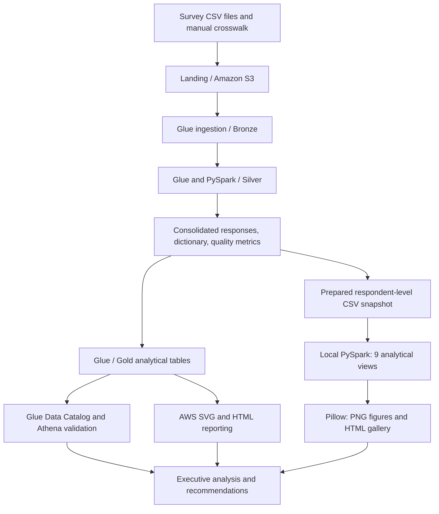

# State of Data Brasil | AWS Data Engineering & Market Intelligence

**FIAP Tech Challenge · Phase 3 · Amazon S3 · AWS Glue · Athena · PySpark**

An end-to-end data engineering and analytics project that consolidates three editions of the State of Data Brasil survey into a traceable analytical foundation for studying Brazil's data, analytics, and AI workforce.

The work spans **cloud architecture, ingestion, schema harmonization, data quality, distributed transformations, analytical tables, visual reporting, and executive recommendations**. A local reproduction path makes the indicators inspectable without AWS credentials.

**14,002 unique survey responses · 3 editions · 457-row manual crosswalk · 9 analytical views · 17-page executive report**

[Executive report](docs/tech-challenge-phase-3-executive-report.pdf) · [AWS pipeline](aws_pipeline/) · [Treatment notebook](tratamento_dados/01_pipeline_tratamento_consolidacao.ipynb) · [Chart gallery](saidas/) · [Run locally](#reproduce-the-indicators-locally)


## Business objective

Turn survey data into evidence for decisions about talent attraction, skills development, technology investment, diversity, and working arrangements.

The analysis covers roles and seniority, compensation bands, regional distribution, gender representation, technology preferences, AI adoption, barriers to AI use, LLM project maturity, and work-model preferences or intentions.

The technical challenge extends beyond combining CSV files: questions, codes, labels, and answer options change between editions. Reliable comparison requires reviewing their meaning before aggregating the responses.

## Competencies demonstrated

| Area | Concrete evidence |
|---|---|
| Cloud data architecture | S3 Bronze/Silver/Gold layers, Glue processing, catalog integration, and Athena validation |
| Data ingestion | Landing-to-Bronze script with source metadata, question dictionary, Parquet output, and catalog registration |
| Distributed processing | PySpark DataFrames, explicit casts, normalization, deduplication, unions, aggregations, and window functions |
| Schema harmonization | A manually reviewed 457-row crosswalk connecting equivalent survey questions |
| Data quality and traceability | Coverage validation, duplicate checks, source/year provenance, dictionary exports, and quality metrics |
| Analytical data products | Gold tables organized around business questions, with edition-aware counts and percentages |
| Storage design | CSV exports and Silver Parquet partitioned by survey year |
| Analytical interpretation | Separating partial-edition effects from composition changes and preserving non-equivalent questions |
| Visualization | Nine modular analyses, PNG charts, a browsable local HTML report, and AWS SVG/HTML publication scripts |
| Executive communication | A 17-page report connecting architecture and findings to business opportunities |

The competency evidence is in the implemented pipeline and analytical artifacts. Technologies named by survey respondents, such as Power BI, BigQuery, and Databricks, are analyzed categories; they are not all implementation tools used by this project.

## Architecture and execution paths



| Component | Responsibility | Implementation evidence |
|---|---|---|
| Amazon S3 | Store inputs and Bronze, Silver, and Gold products | [S3 evidence](AWS/S3-Bucket.png) |
| AWS Glue ingestion | Read source files and produce structured Bronze outputs | [Ingestion script](aws_pipeline/01_bronze_ingestao/job_landing_to_bronze.py) |
| AWS Glue / PySpark | Harmonize and consolidate the survey editions | [Silver treatment job](aws_pipeline/02_silver_tratamento/job_silver_corrigido.py) |
| Glue Data Catalog | Make prepared data available to downstream jobs and query tools | [Glue evidence](AWS/Glue.png), [Gold job](aws_pipeline/03_gold_indicadores/job_gold_indicadores.py) |
| Amazon Athena | Query and validate cataloged analytical data | [Athena evidence](AWS/Athena.png) |
| Gold reporting jobs | Produce analytical tables and publish visual outputs | [Gold scripts](aws_pipeline/03_gold_indicadores/), [visual reporting](aws_pipeline/04_gold_graficos/) |
| Local PySpark and Pillow | Recalculate indicators and render charts from a prepared export | [Runner](gerar_todos.py), [processing helpers](codigo/spark_comum.py), [rendering helpers](codigo/comum.py) |

**Cloud execution and local reproduction have different entry points.** The AWS artifacts preserve the group's pipeline scripts and execution evidence. Local commands read the committed respondent-level snapshot; they do not invoke Glue jobs, query Athena, or write to S3.

## Data coverage

The input snapshot is [dados/state_of_data_gold_export.csv](dados/state_of_data_gold_export.csv). Despite its filename, it is **respondent-level prepared data**, not one of the aggregated Gold tables.

| Stored `ano_pesquisa` | Survey edition | CSV rows | Unique response keys | Status at analysis time |
|---|---|---:|---:|---|
| `2023` | 2023–2024 | 5,293 | 5,293 | Closed |
| `2024` | 2024–2025 | 5,217 | 5,215 | Closed |
| `2025` | 2025–2026 | 3,495 | 3,494 | Partial collection |
| **Total** | **Three editions** | **14,005** | **14,002** | Snapshot used by the project |

Unique responses are identified by `ano_pesquisa + id_resposta`. Local preparation removes three repeated keys from the snapshot.

The survey is identified in the executive report as a Data Hackers and Bain & Company initiative. Public source datasets can be found through [Data Hackers on Kaggle](https://www.kaggle.com/datahackers/datasets).

“Partial” describes the edition **when this snapshot was analyzed**. It is not a claim about the survey's live collection status today.

## Engineering workflow

### 1. Ingest and preserve source context

The Landing/Bronze stage keeps source context available for downstream processing. The preserved [ingestion job](aws_pipeline/01_bronze_ingestao/job_landing_to_bronze.py) reads the configured manifest, assigns stable positional column identifiers, writes structured Parquet outputs, registers edition tables, and creates a question dictionary.

The [Bronze screenshot](AWS/S3-Bronze.png) documents the source area used in the project. The original edition files and the structured products described by the ingestion script are distinct artifacts.

### 2. Profile and reconcile changing survey schemas

The [treatment notebook](tratamento_dados/01_pipeline_tratamento_consolidacao.ipynb) documents profiling and consolidation. The [manual crosswalk](tratamento_dados/02_crosswalk_manual.csv) records **457 mapping rows** across editions.

The crosswalk addresses a semantic problem: the same question code can be reused for different content, while equivalent questions can receive different codes.

The process:

1. Place original question codes, labels, and columns side by side.
2. Review equivalence manually.
3. Map equivalent content to canonical columns.
4. Separate edition-specific questions when their meaning differs.
5. Validate that every original column appears exactly once in the mapping.

Validation rejects missing, duplicated, or unexpected source-column mappings. This prevents a plausible-looking merge from silently combining incompatible answers.

### 3. Standardize each edition before consolidation

The treatment applies canonical names, whitespace cleanup, type conversion, age and timestamp handling, binary-flag normalization, and exact-duplicate removal within each edition. It preserves `ano_pesquisa` and `arquivo_origem` for provenance.

The notebook uses a single projection for its per-column transformations rather than repeatedly chaining hundreds of `withColumn` operations. This keeps the Spark analysis plan manageable for a wide survey schema.

### 4. Consolidate with UNION

The editions contain separate survey responses. They are stacked with:

```python
df23.unionByName(df24, allowMissingColumns=True) \
    .unionByName(df25, allowMissingColumns=True)
```

Canonical naming happens first, and absent questions become null. This preserves the response grain without inventing a person-level join across years.

The notebook checks that the consolidated row count equals the sum of the treated editions. Outputs include a consolidated CSV, a question dictionary, and Parquet **partitioned by survey year** to support year-based reads.

### 5. Produce analytical Gold tables

The [Gold indicators job](aws_pipeline/03_gold_indicadores/job_gold_indicadores.py) reads prepared Silver data through the Glue Catalog, handles repeated response keys, and aggregates business dimensions.

Counts, percentages, and rankings use Spark operations such as `groupBy`, `countDistinct`, and `Window.partitionBy`. Gold products support comparisons of workforce profiles, technology choices, AI adoption, and work arrangements.

The repository also preserves the [Glue visual job script](aws_pipeline/03_gold_indicadores/job_gold_indicadores_visual.py) and native Glue Studio JSON exports, allowing inspection of both code and exported job configuration.

### 6. Publish and reproduce the visual analysis

The [AWS reporting job](aws_pipeline/04_gold_graficos/job_gold_graficos.py) reads analytical products and publishes SVG/HTML outputs. The local path uses [gerar_todos.py](gerar_todos.py), shared PySpark preparation, nine analysis modules, and Pillow rendering.

Local preparation also explicitly corrects technology-column semantics for earlier editions. Aggregated values are collected for drawing after Spark has performed the analytical processing.

## Nine analytical views

| View | Business question | Source module | Output |
|---|---|---|---|
| Respondents by edition | How much observed survey coverage is available? | [01](codigo/grafico_01_respondentes.py) | [PNG](saidas/01_respondentes_por_ano.png) |
| Roles and seniority | How does the participant profile vary across editions? | [02](codigo/grafico_02_funcoes_e_niveis.py) | [PNG](saidas/02_funcoes_e_niveis.png) |
| Compensation by seniority | How are salary bands distributed within professional levels? | [03](codigo/grafico_03_faixa_salarial_por_nivel.py) | [PNG](saidas/03_faixa_salarial_por_nivel.png) |
| Regional profile | Where are respondents concentrated? | [04](codigo/grafico_04_perfil_regional.py) | [PNG](saidas/04_perfil_regional.png) |
| Gender and seniority | How does gender representation vary by level? | [05](codigo/grafico_05_diversidade_genero_senioridade.py) | [PNG](saidas/05_diversidade_genero_senioridade.png) |
| Technology preferences | Which languages, cloud, BI, lake, and warehouse technologies are cited? | [06](codigo/grafico_06_tecnologias_principais.py) | [PNG](saidas/06_tecnologias_principais.png) |
| AI adoption and priority | How do organizations position and use AI? | [07](codigo/grafico_07_adocao_prioridade_ia.py) | [PNG](saidas/07_adocao_prioridade_ia.png) |
| AI barriers and LLM projects | What blocks adoption, and what project stages are reported? | [08](codigo/grafico_08_motivos_nao_ia_resultados_llm.py) | [PNG](saidas/08_motivos_nao_ia_resultados_llm.png) |
| Working arrangements | What do preference and return-to-office questions reveal? | [09](codigo/grafico_09_modelo_trabalho.py) | [PNG](saidas/09_modelo_trabalho.png) |


[Open the full PNG overview](saidas/00_previa_tres_anos.png). For the browsable report, download or clone the repository and open `saidas/index.html` locally; GitHub's file viewer displays its source rather than serving it as a website. Original chart labels are in Portuguese.

## Executive findings and decisions they inform

The [17-page executive report](docs/tech-challenge-phase-3-executive-report.pdf) brings together architecture evidence, analytical charts, interpretation, opportunities, and conclusions.

| Finding in the report | Decision relevance |
|---|---|
| Analytics and BI remain a large share of respondents, while engineering and data science/AI gain participation | Plan complementary technical profiles and skills development |
| Compensation distributions vary by seniority and specialization | Use segmented compensation benchmarks |
| Respondents are strongly concentrated in the Southeast | Consider geographically broader recruitment |
| Gender imbalance persists across the editions | Design inclusion and talent-development initiatives |
| Python, cloud platforms, and BI tools are recurring survey themes | Align training with the technologies relevant to the target workforce |
| Expertise, resources, use-case understanding, and security/privacy appear among AI adoption barriers | Connect AI investment with readiness, training, and governance |
| Work flexibility remains relevant, with a changed question in the latest edition | Assess retention and recruitment implications without treating different questions as one trend |

These are findings from the observed survey participants and the project's historical snapshot. They support strategic discussion, rather than proving population-wide labor-market changes or the impact of a particular business intervention.

### AI analysis and applied machine learning in the project series

This phase studies **reported AI adoption and LLM project maturity**. It does not train an LLM or deploy a predictive model. The applied machine learning workflow—training, class weighting, evaluation, and interpretation—is documented in [Phase 2](https://github.com/joaomottin/TechChallenge-Fase2).

## Comparability and data quality decisions

- **Partial edition:** show observed response volume as accumulated coverage. Use within-edition percentages where raw counts would be distorted by different sample sizes.
- **Changing questions:** preserve the distinction between ideal work-model preferences in 2023/2024 and intentions in response to a return-to-office scenario in 2025–2026.
- **Different respondents:** consolidated editions are repeated cross-sectional samples, not a panel following the same individuals.
- **Missing answers and multiple selections:** inspect each module's denominator and selection rules; technology mentions and respondent counts are not interchangeable.
- **Salary categories:** the local chart consolidates salary bands, including an above-R$20,000 category. Read this grouping before comparing it with finer salary claims in the original report.
- **Snapshot lineage:** the prepared CSV is not a live query and is not an aggregated Athena Gold table.
- **Evidence scope:** AWS screenshots show resource state at the time of execution. They are historical evidence, not a live deployment status check.

## Reproduce the indicators locally

Use **Python 3.10+** and a Java installation compatible with the declared **PySpark 3.5.x** dependency. Java 17 is a suitable choice; make Java available to Spark through `JAVA_HOME` and/or the system path.

From the repository root:

```bash
python -m venv .venv
```

Activate with `.venv\Scripts\Activate.ps1` in PowerShell or `source .venv/bin/activate` on macOS/Linux, then run:

```bash
python -m pip install -r requirements.txt
python gerar_todos.py
```

The dependency file declares PySpark, pandas, and Pillow. Ensure an authorized copy of `dados/state_of_data_gold_export.csv` is available before execution.

The runner produces nine analytical PNGs, `00_previa_tres_anos.png`, `index.html`, and `LEIA-ME.txt` in `saidas/`. Open the HTML file in a browser after execution. Existing output files are replaced.

To reproduce an individual view:

```bash
python -m codigo.grafico_06_tecnologias_principais
```

### Reproducing the original treatment and AWS jobs

The treatment notebook targets **Google Colab** and uses paths such as `/content/data` and `/content/output`. Supply the three source-edition CSVs and the manual crosswalk, then adapt its paths if running elsewhere. The respondent snapshot alone does not replace those source inputs.

AWS scripts require Glue, S3 resources, catalog setup, IAM permissions, job arguments, and the original environment configuration. They preserve the executed logic; the repository does not provide a one-command infrastructure deployment. Inspect [pipeline documentation](aws_pipeline/README.md) before adapting them.

## Deliverables and repository guide

| Artifact | Purpose |
|---|---|
| [Executive report](docs/tech-challenge-phase-3-executive-report.pdf) | Original 17-page technical and business narrative |
| [Treatment notebook](tratamento_dados/01_pipeline_tratamento_consolidacao.ipynb) | Profiling, schema alignment, transformations, consolidation, and validation |
| [Manual crosswalk](tratamento_dados/02_crosswalk_manual.csv) | Auditable question equivalence across editions |
| [AWS pipeline](aws_pipeline/) | Ingestion, Silver, Gold, and reporting scripts plus Glue exports |
| [AWS evidence](AWS/) | Architecture diagram and S3, Glue, and Athena screenshots |
| [Local analysis modules](codigo/) | Shared Spark processing and nine independently runnable views |
| [Prepared snapshot](dados/) | Respondent-level input and provenance documentation |
| [Visual outputs](saidas/) | Nine charts, overview, HTML gallery, and execution notes |
| [Delivery map](docs/MAPA_ENTREGA.md) | Additional documentation of the cloud/local relationship |

```text
AWS/                    Architecture and cloud execution evidence
aws_pipeline/
  01_bronze_ingestao/    Ingestion script
  02_silver_tratamento/  Treatment job and Glue export
  03_gold_indicadores/   Analytical jobs and Glue export
  04_gold_graficos/      Visual reporting job and Glue export
tratamento_dados/       Treatment notebook and manual crosswalk
dados/                  Prepared respondent snapshot
codigo/                 Spark helpers, rendering, and nine analyses
saidas/                 PNG charts and browsable local HTML report
docs/                   Executive report and delivery map
gerar_todos.py          Consolidated local runner
requirements.txt        Python dependencies
```

## Project series

| Phase | Focus | Repository |
|---|---|---|
| 1 | Marketplace analytics, satisfaction metrics, and executive recommendations | [Olist seller analysis](https://github.com/joaomottin/TechChallenge-Fase1) |
| 2 | Supervised learning, imbalanced classification, and model interpretation | [Wine quality](https://github.com/joaomottin/TechChallenge-Fase2) |
| 3 | Cloud architecture, distributed data preparation, and market intelligence | [State of Data Brasil](https://github.com/joaomottin/TechChallenge-Fase3) |

## Team

Developed collaboratively for FIAP.

| Contributor | Student ID |
|---|---|
| Felipe Macedo da Silva | RM373436 |
| João Pedro Mezzadri Mottin | RM372545 |
| Miguel Fernandes Martins de Bastos | RM373815 |
| Thanael Butewicz | RM373935 |
| Verônica de Fátima Machado Silva | RM371976 |
